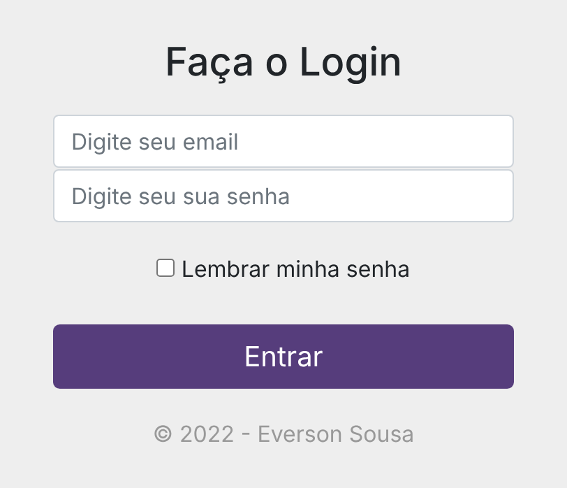

# Login Bootstrap

Tela de login responsiva feita com **HTML, CSS e Bootstrap 4**: formulário com e-mail, senha, opção "Lembrar minha senha" e botão de entrada.

🔗 **Demo:** [evssousa.github.io/login-bootstrap](https://evssousa.github.io/login-bootstrap/)

<p align="center">
  
</p>

> Este projeto é apenas a **interface** (front-end): não há servidor nem autenticação de verdade.

## Funcionalidades

- Formulário de login centralizado na tela, com largura máxima de 350px
- Campos de e-mail e senha com validação básica do navegador (`type="email"`)
- Checkbox "Lembrar minha senha"
- Botão "Entrar" em tamanho grande, com cor personalizada e efeito de hover
- Layout responsivo, que se adapta a telas de celular e de computador

## Tecnologias

- **HTML5**: estrutura do formulário
- **CSS3**: estilos personalizados (centralização com Flexbox e cores do botão)
- **[Bootstrap 4.0](https://getbootstrap.com/docs/4.0/)**: componentes de formulário e botão, carregado por CDN
- **jQuery e Popper.js**: dependências do JavaScript do Bootstrap, também por CDN
- **GitHub Pages**: hospedagem

## Estrutura do projeto

```
login-bootstrap/
├── assets/
│   └── css/
│       └── style.css    # estilos personalizados
├── img/
│   └── preview.png      # print usado neste README
├── index.html           # estrutura da página
└── README.md
```

## Como rodar localmente

Clone o repositório e abra o arquivo no navegador:

```bash
git clone https://github.com/evssousa/login-bootstrap.git
cd login-bootstrap
```

Depois, abra o `index.html` no navegador (duplo clique no arquivo ou, no VS Code, use a extensão Live Server).

> É preciso estar conectado à internet, porque o Bootstrap e o logo são carregados de CDN.

## Como funciona

O Bootstrap cuida da maior parte do visual por meio de classes prontas:

- `form-control`: estiliza os campos de e-mail e senha
- `btn btn-lg btn-primary btn-block`: transforma o botão "Entrar" em um botão grande, que ocupa toda a largura

O arquivo `style.css` complementa o Bootstrap: centraliza o formulário na tela com Flexbox, limita a largura a 350px e troca a cor padrão do botão (azul) por um roxo (`#563d7c`), com um tom mais escuro no hover.

## Ideias de melhorias futuras

- Tratar o envio do formulário com JavaScript, para não recarregar a página
- Adicionar `<label>` nos campos para melhorar a acessibilidade
- Botão para mostrar e ocultar a senha
- Link de "Esqueci minha senha" e de "Criar conta"
- Atualizar para uma versão mais recente do Bootstrap
- Hospedar o logo no próprio projeto, em vez de carregá-lo de outro site

## Autor

**Everson Sousa**, Análise e Desenvolvimento de Sistemas

[](https://github.com/evssousa)
[](https://linkedin.com/in/evssousa)
